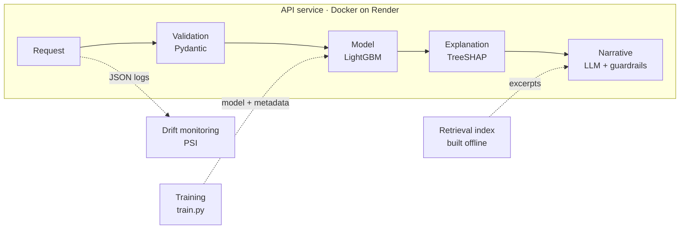

# Credit Risk API: Technical Report

**An end-to-end machine learning system for consumer credit risk: from data to a monitored, explainable production service.**

[Live demo](https://credit-risk-api-uo5r.onrender.com) · [API documentation](https://credit-risk-api-uo5r.onrender.com/docs) · [Source code](https://github.com/JoaoNunes20/credit-risk-api)

## Summary

This report describes the design, implementation and evaluation of a service that estimates the probability that a consumer loan application will default, and explains each estimate. The project prioritises the engineering around the model over the model itself: input validation, testing, containerisation, continuous integration and deployment, drift monitoring, and explanations grounded in EU credit guidelines.

Key results:

- A LightGBM classifier on 11 features reaches a test ROC AUC of **0.750**, after excluding sex, age, family status and region on regulatory grounds, at a cost of about 0.005 AUC.
- The model is served by a FastAPI service with strict input validation, covered by **30 automated tests**, packaged with Docker and deployed on Render only after CI checks pass.
- Input drift is monitored with the **Population Stability Index (PSI)**; in a simulated shift, it flagged exactly the two altered features and none of the other nine.
- Each estimate can be explained with exact **SHAP values** and with a plain-language paragraph written by an LLM, which cites the **EBA Guidelines on loan origination and monitoring** through an offline retrieval index. Output faithfulness is enforced in code rather than left to the prompt.

## Contents

1. [Problem and scope](#1-problem-and-scope)
2. [System architecture](#2-system-architecture)
3. [Data](#3-data)
4. [Model and feature selection](#4-model-and-feature-selection)
5. [Sensitive attributes](#5-sensitive-attributes)
6. [Serving](#6-serving)
7. [Testing, packaging and delivery](#7-testing-packaging-and-delivery)
8. [Monitoring](#8-monitoring)
9. [Explainability](#9-explainability)
10. [Interactive demo](#10-interactive-demo)
11. [Limitations and future work](#11-limitations-and-future-work)
12. [References](#12-references)

## 1. Problem and scope

Given a loan application, the service returns the probability that the applicant will have payment difficulties, the contribution of each input to that estimate, and, on request, a short explanation for a loan officer.

The scope is deliberately an engineering one. The model is a strong but simple baseline; the effort goes into the parts a production credit model needs around it: a validated interface, reproducibility, automated quality gates, observability and explanations that can be trusted. The estimate is intended to support, not replace, a human credit decision.

## 2. System architecture



Every request follows the same path: it is validated against a strict schema, scored by the model, decomposed into feature contributions and, optionally, turned into a narrative. Training and the retrieval index are built offline and versioned with the code. Every change to the code goes through the delivery pipeline:


## 3. Data

The data is the `application_train.csv` table of the [Home Credit Default Risk](https://www.kaggle.com/competitions/home-credit-default-risk) Kaggle competition: 307,511 applications and 122 columns. The target is binary and imbalanced: 8.1% of applicants defaulted. A model that always predicted "no default" would be 92% accurate, so models are evaluated with ROC AUC.

Exploratory analysis surfaced three properties that shaped both the model and the API:

| Finding | Detail | Consequence |
| --- | --- | --- |
| Placeholder value in `DAYS_EMPLOYED` | 365243 appears in about 18% of rows; 55,352 of the 55,374 affected applicants are pensioners | Treated as missing; the API accepts `null` for applicants who are not employed |
| Rare category in `CODE_GENDER` | `XNA` appears for 4 applicants | Too rare to learn from; the attribute was later excluded entirely |
| Missing external scores | `EXT_SOURCE_1` is missing for 56.4% of applicants, `EXT_SOURCE_3` for 19.8%, `EXT_SOURCE_2` for 0.2% | Missing values are handled natively by LightGBM; the API accepts them as optional |

## 4. Model and feature selection

### Model

The model is a LightGBM gradient-boosted tree classifier (500 trees, learning rate 0.05, 31 leaves) trained on a stratified 80/20 split with a fixed random seed. Categorical features use LightGBM's native categorical handling; missing values are learned as their own split direction.

### Feature selection

Two selection methods were compared against an initial hand-picked set of 12 features.

**Ablation.** The model was retrained 12 times, each time without one feature, and the drop in test AUC recorded. The three external credit scores dominate: removing `EXT_SOURCE_3` costs 0.030 AUC and `EXT_SOURCE_2` 0.024, more than all other features combined. Income contributes less than 0.001.

**Information Value (IV).** IV, the standard univariate screening metric in credit scoring, was computed on the training split for all 120 candidate features. The comparison on the same test set:

| Feature set | Features | Test AUC |
| --- | --- | --- |
| Hand-picked baseline | 12 | 0.7538 |
| Top 12 by IV | 12 | 0.7470 |
| Top 12 by IV, near-duplicate removed, loan amount added | 12 | 0.7493 |
| As above, without `ORGANIZATION_TYPE` | 11 | 0.7501 |

IV-based selection underperformed the baseline. IV scores each feature in isolation, so it misses the interactions a tree model exploits: the loan amount, the annuity and the price of the goods are individually weak but jointly describe the loan term and the loan-to-value ratio. IV also favoured `ORGANIZATION_TYPE`, whose 58 categories inflate IV and caused the model to overfit.

### Final feature set

| Group | Features |
| --- | --- |
| External credit scores | `EXT_SOURCE_1`, `EXT_SOURCE_2`, `EXT_SOURCE_3` |
| Loan and income amounts | `AMT_INCOME_TOTAL`, `AMT_CREDIT`, `AMT_ANNUITY`, `AMT_GOODS_PRICE` |
| Employment | `DAYS_EMPLOYED`, `OCCUPATION_TYPE` |
| Other | `NAME_CONTRACT_TYPE`, `NAME_EDUCATION_TYPE` |

The final model reaches a test AUC of **0.7497**. The small difference from the 0.7519 measured for the same feature set during selection comes from a different test split (four rows were no longer filtered), which indicates a single-split noise level of about 0.002 AUC. Differences of that size between candidate models should not be treated as conclusive.

## 5. Sensitive attributes

Attributes that may not, or should not, be used in EU consumer credit decisions were excluded by design:

| Attribute | Reason for exclusion |
| --- | --- |
| Sex (`CODE_GENDER`) | Gender may not be used in EU credit decisions (Directive 2004/113/EC) |
| Age (`DAYS_BIRTH`) | Protected characteristic; excluded as a precaution |
| Family status (`NAME_FAMILY_STATUS`, `CNT_CHILDREN`, `CNT_FAM_MEMBERS`) | Sensitive; excluded as a precaution |
| Region (`REGION_RATING_CLIENT*`, `REGION_POPULATION_RELATIVE`) | Potential proxies for protected groups |

The cost of the exclusions was measured rather than assumed:

| Variant | Features | Test AUC |
| --- | --- | --- |
| Baseline, including sex and age | 12 | 0.7538 |
| Sex and age removed | 10 | 0.7492 |
| Education also removed | 9 | 0.7461 |
| Sex and age removed, occupation added (final) | 11 | 0.7519 |

The exclusion list, with the reason for each attribute, is defined in the training code, stored in the model's metadata, exposed by the API's `/model-info` endpoint and enforced by a test.

Removing an attribute does not guarantee the model cannot recover it. Occupation is correlated with sex for some occupations, and the external scores are produced by third parties that may use age. A bias audit across protected groups is listed as future work.

## 6. Serving

### Endpoints

| Method | Endpoint | Description |
| --- | --- | --- |
| `GET` | `/` | Interactive demo page |
| `GET` | `/health` | Liveness check, used by the platform's health checks |
| `GET` | `/model-info` | Model features, excluded attributes and test AUC |
| `POST` | `/predict` | Probability of default for one application |
| `POST` | `/explain` | Prediction plus the SHAP contribution of each feature |
| `POST` | `/explain/narrative` | `/explain` plus an LLM-written explanation with cited sources |

### Input validation

Requests are validated with Pydantic before they reach the model. External scores must lie in [0, 1], amounts must be positive, days employed must be negative or `null`, and categorical fields accept only the categories seen in training. Invalid requests receive a `422` response naming the field and the violated rule. Without this, an unknown category would silently become a missing value and the model would return a plausible but meaningless estimate.

### Training/serving consistency

Training writes a `metadata.json` file with the feature order and the categories of each categorical feature. The service uses it twice:

- **At startup**, it compares its input schema with the metadata and refuses to start if they differ, so a retrained model can never be served with a stale schema.
- **On each request**, it rebuilds the input with the training column names, order and data types before calling the model, avoiding training/serving skew.

## 7. Testing, packaging and delivery

### Tests

A suite of 30 pytest tests runs in about two seconds. It covers normal operation, every class of invalid input, the exclusion of sensitive attributes, the additivity of SHAP values (baseline plus contributions must reproduce the prediction), the explanation endpoints with the LLM replaced by a stub, the output guardrails, and the drift computation on synthetic data. No test depends on network access or secrets.

### Packaging

The service is packaged as a Docker image based on `python:3.13-slim`, with the OpenMP runtime LightGBM requires. Dependencies are installed with uv from a lock file in a separate, cached layer, so code-only changes rebuild in seconds. Development tools are excluded from the image.

### Continuous integration and deployment

A GitHub Actions workflow runs on every push and pull request: it installs the locked dependencies and runs the tests, then builds the Docker image, starts a container and checks that `/health` responds. Render deploys a commit only after these checks pass, with one-click rollback to earlier versions. The service listens on the port provided by the platform, falling back to 8000 locally, so the same image runs unchanged in both environments. The LLM API key is supplied as an environment variable and never committed.

At 1.7 MB, the trained model is versioned with the code that serves it. A larger model would be stored in a model registry or object storage and fetched at build or start time.

## 8. Monitoring

### Prediction logging

Each prediction is logged as a single JSON line with the estimated probability, the latency and the validated inputs. The inputs contain no names or identifiers, but they are personal financial data; in a production lending context, logging them would require a GDPR legal basis, data minimisation and a retention policy.

### Input drift

A model can degrade without raising errors when incoming applicants stop resembling the training population. Drift is measured per feature with the Population Stability Index:

```math
\mathrm{PSI} = \sum_i \left(a_i - e_i\right) \ln \frac{a_i}{e_i}
```

where $e_i$ and $a_i$ are the shares of the reference (training) and actual (incoming) data in bin $i$.

At training time, the reference distribution of each feature is stored: decile bins for numeric features and frequencies for categorical ones, with missing values in their own bin, so that a sudden rise in missing data is also detected. Features are classified as stable (PSI < 0.1), warning (0.1 to 0.25) or alert (≥ 0.25).

The monitor was evaluated on 2,000 requests drawn from the held-out test set, in two scenarios:

| Feature | Stable scenario | Shifted scenario |
| --- | --- | --- |
| `AMT_INCOME_TOTAL` (incomes +30%) | 0.004 | **0.758 (alert)** |
| `NAME_CONTRACT_TYPE` (30% of cash loans turned revolving) | 0.000 | **0.478 (alert)** |
| Other 9 features | ≤ 0.012 | unchanged |

The monitor flagged exactly the two altered features. Income responds strongly because reported incomes cluster at round values that coincide with decile edges, so a proportional shift moves whole groups across bins.

Input drift is an early warning, not a measure of model quality: whether the model has degraded can only be measured once outcomes are known, which in consumer credit takes months.

## 9. Explainability

### Feature contributions

`/explain` returns exact SHAP values computed with LightGBM's native TreeSHAP (`pred_contrib=True`), which avoids an additional library on a server with 512 MB of memory. Contributions are in log-odds and, together with the baseline, sum exactly to the model's output. For the example applicant used throughout the project:

| Feature | Value | Contribution (log-odds) |
| --- | --- | --- |
| Education | Higher education | −0.228 |
| External credit score 3 | 0.55 | −0.186 |
| External credit score 2 | 0.60 | −0.160 |
| Loan amount | 500,000 | +0.137 |
| External credit score 1 | 0.50 | −0.126 |
| Price of goods | 450,000 | +0.123 |
| Remaining five features | | between −0.005 and +0.084 |

The baseline of −2.826 (5.6%) plus the contributions gives −3.068, a probability of default of 4.4%. Education being the strongest single factor for this applicant illustrates the value of per-decision explanations: a feature retained despite its potential role as a socioeconomic proxy can be decisive in individual cases.

### LLM-written explanations

`/explain/narrative` asks an LLM to turn the contributions into a short paragraph for a loan officer. The service uses any OpenAI-compatible API; the default is `openai/gpt-oss-120b` on Groq's free tier, which does not use requests for training. Provider and model are configuration, not code.

Early versions produced fluent but unfaithful text: they invented a currency, described a mid-range score of 0.55 as "very good", described 5.5 years of employment as "short", and claimed that the explanation "follows the EBA guidance". Each error was plausible enough to go unnoticed, which is what makes such errors dangerous in a credit context. The fixes move every judgement out of the LLM and into code:

- **Deterministic facts.** The code converts days of employment into years, formats amounts without a currency, and labels each contribution with fixed thresholds: strong (≥ 0.15), moderate (≥ 0.05), small (≥ 0.02) or negligible. The LLM never sees raw column names.
- **Output guardrail.** Each response is scanned for value judgements and compliance claims. If any are found, the LLM is asked once to rewrite without them, and the event is logged.
- **No decisions.** The prompt forbids recommending approval or rejection.

Prompt rules alone proved unreliable: the same rule held in one run and failed in another, especially as the prompt grew. Properties that matter are therefore guaranteed by code and verified by tests.

### Retrieval over regulation

The narrative relates the explanation to excerpts from the EBA Guidelines on loan origination and monitoring (EBA/GL/2020/06), returned as numbered sources with section and page. The retrieval index is built offline:

1. The guidelines are split into overlapping chunks of about 1,000 characters that keep their section and page, with the running page header removed.
2. Chunks are embedded locally with `BAAI/bge-small-en-v1.5`, so no API key is needed and no data leaves the build machine.
3. Each model feature maps to a regulatory topic, and the most relevant chunk for each topic is retrieved once, at build time.

Because queries come from a closed set of topics rather than free text, the service needs no embedding model and no vector database at runtime. At request time it selects the precomputed excerpts for the three strongest distinct topics of the application, plus the guidelines' paragraph on automated credit models. For 199 chunks, NumPy cosine similarity replaces a vector database.

Retrieval was evaluated by inspecting the top results for every topic:

| Round | Problem found | Correction |
| --- | --- | --- |
| 1 | Consumer topics retrieved passages on ship financing, commercial real estate and the executive summary | Queries reworded for consumer lending; page headers removed; index restricted to the guidelines and their annexes |
| 2 | Several results came from the section on monitoring existing loans | That section excluded from the index |
| 3 | Top results relevant for all topics except income | Accepted and documented as a limitation |

The evaluation showed that second-ranked results were consistently weaker, so only the top result per topic is used, and that a similarity threshold would not help: relevant and irrelevant chunks scored in the same 0.69 to 0.83 range. Citations in generated explanations were checked manually against the cited excerpts; no fabricated citations were found.

## 10. Interactive demo

The root URL serves a single-page demo built from a static HTML file, with no additional dependencies. It runs an estimate on load, offers four preset applicants (an example applicant, a strong credit history, a retired applicant and a large loan with little credit history), shows the estimate on a scale against the typical applicant, plots the SHAP contributions, and requests an LLM explanation on demand. Dropdown options are read from the API's OpenAPI schema, so the page cannot drift from the model's categories, and validation errors are shown next to the relevant field.

## 11. Limitations and future work

| Limitation | Possible next step |
| --- | --- |
| Model comparisons rely on a single train/test split | Cross-validation for model selection |
| Excluded attributes may be partly recovered through proxies such as occupation and external scores | Bias audit of outcomes across protected groups |
| The output guardrail catches known phrasings but not paraphrases | An LLM-as-a-judge check or human review of a sample |
| Citations are faithful but not always tied to a specific factor | Prompting the LLM to link each excerpt to the factor it concerns |
| Retrieval for income is weak, as the EBA guidelines say little about consumer income | Adding the Consumer Credit Directive (EU) 2023/2225 to the index |
| Chunk boundaries can split words | Splitting chunks at word boundaries |
| The free hosting tier sleeps when idle and has 512 MB of memory | A paid tier for production use |

## 12. References

- European Banking Authority. *Guidelines on loan origination and monitoring* (EBA/GL/2020/06). [eba.europa.eu](https://www.eba.europa.eu/regulation-and-policy/credit-risk/guidelines-on-loan-origination-and-monitoring)
- Council Directive 2004/113/EC implementing the principle of equal treatment between men and women in the access to and supply of goods and services.
- Home Credit Group. *Home Credit Default Risk*, Kaggle competition. [kaggle.com](https://www.kaggle.com/competitions/home-credit-default-risk)
- Lundberg, S. M. et al. (2020). From local explanations to global understanding with explainable AI for trees. *Nature Machine Intelligence*, 2, 56–67.
- Ke, G. et al. (2017). LightGBM: A highly efficient gradient boosting decision tree. *Advances in Neural Information Processing Systems*, 30.
